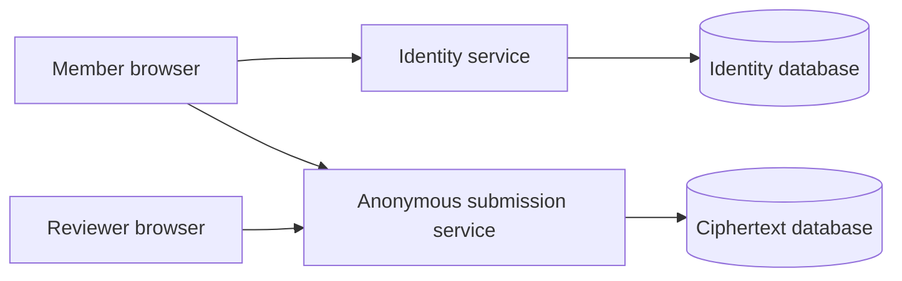

<!-- SPDX-FileCopyrightText: 2026 Anonce Contributors -->
<!-- SPDX-License-Identifier: AGPL-3.0-only -->

# Architecture

Audience: implementers, reviewers, and operators evaluating system boundaries.

The [browser application](deployment.md#browser-mvp-local-startup) connects accounts,
encrypted member backups, enrollment, publication, blind authorization, anonymous
acceptance and local review. Use synthetic data only. Protected signers, recovery,
public transparency and broader product policy remain Next work.

## Components and ownership

| Component | Holds | Must not receive |
| --- | --- | --- |
| Identity account service | Passkey credentials, sessions, eligible rounds, encrypted member backups | Plaintext device keys, unlock secrets, answers, receipts or reply capabilities |
| Membership CA and enrollment | Invitation digests, member public keys/certificates, membership state | Member private keys |
| Token issuer | Membership eligibility and per-member/round reservation | Unblinded tokens or submission content |
| Submission service | Common bulletins, spent-token digests, ciphertext, signed acceptance | Accounts, identity cookies, member keys/certificates, plaintext answers |
| Member worker | Local signing key and validated enrollment/issuance context | Server signing keys |
| Anonymous worker | Blind state, token, answer, retry payload and acceptance | Identity credentials or member key |
| Reviewer worker | Round private key and locally decrypted answers | Enrollment identities |

The CA and issuer compose within the identity service, with distinct signing keys.
The submission service has its own process, state, credential and PostgreSQL instance.
Public transparency and administrative audit are planned separate components, not
properties of signed storage acceptance.

## Trust boundaries

These are privacy boundaries within one user journey, not alternate workflows.
No process connects to both databases. See [storage](database.md) and
[deployment](deployment.md#production-separation). A shared host administrator can
still observe both services; containers do not establish independent operators.

## Client and server contract

- Members, reviewers and administrators use browser forms. Installation, manual
  key generation, certificate-request handling and key files are not user steps.
- Go embeds first-party HTML, CSS and ES modules and serves matched WASM/worker
  artifacts with original notices. There is no product Node build, CDN or analytics.
- Device cryptography stays in shared Go packages, composed in dedicated workers.
  The server never receives unlock material or decrypts answers.
- Public text is escaped; decrypted reviewer text renders locally with `textContent`.
- Authentication, local unlocking and anonymous authorization remain separate checks.
  A passkey is not an encryption key or membership certificate.

## Account and anonymous flow

### Implemented browser MVP boundary

The identity origin owns account sign-in, encrypted member backup, invitations,
enrollment, eligible-round navigation and role-authorized publication. Reviewer
encrypted backups stay in identity-origin browser storage, not the account vault.

A member opens a common round link. The anonymous worker prepares blind state and
opens the configured identity authorization popup. Both windows validate exact
sender origin/window, round, message shape and byte bounds. Only a blinded request
and blind signature cross the handoff. The identity worker validates the signed
bulletin and blinded-request hash before profile-bound signing, after explicit
local unlock and consent.

The anonymous worker finalizes the token, pads/encrypts the answer and verifies the
signed acceptance after durable storage. Tokens, plaintext, pending retry payloads
and receipts remain anonymous-page memory. They do not enter the account vault or
dashboard. Closing/reloading/expiry loses this state; failed issuance can consume
the sole allowance without acceptance or refund.

Anonymous requests omit account credentials. The submission API rejects cookies
and Authorization headers. Only public publication and round-scoped reviewer read
allow exact identity-origin CORS, without credentials. Reviewer access proves local
X25519 decryption, not account-cookie possession. Server read expiry cannot recall
keys, ciphertext or plaintext already obtained.

Publication signatures use an operator-configured trust key. Independent
checkpoint comparison and split-view detection are not implemented. The
[profile](cryptography.md#browser-mvp-profile-1), [API](api.md) and
[threat model](threat-model.md) define the remaining limitations.

## Package boundaries

| Location | Responsibility |
| --- | --- |
| `cmd/browser-identity`, `cmd/browser-submission` | Thin service entry points, each opening only its own runtime database |
| `cmd/browser-init`, `internal/browserapp` | Operator state initialization, scoped configuration and startup |
| `internal/service`, `internal/browserhttp` | Bounded TLS lifecycle and exact-origin HTTP admission |
| `internal/browseridentity`, `internal/browsersubmission` | Browser transport composition and authorization |
| `internal/identity/accounts`, `internal/identity/memberbackup` | Digest-only sessions, expiry/revocation and owner-scoped encrypted member backup |
| `internal/identity/browser` | WebAuthn credentials/ceremonies, enrollment, publication and quota persistence |
| `internal/submission/records`, `internal/submission/browser` | Atomic immutable spends/ciphertext and browser publication/review storage |
| `internal/client` | Shared device-side backups, typed keys, fixed requests and member sessions |
| `cmd/memberwasm`, `internal/memberwasm`, `internal/memberworker` | Member bridge and bounded dedicated-worker ownership |
| `cmd/reviewwasm`, `internal/reviewwasm`, `internal/reviewprofile` | Browser protocol composition, anonymous encryption and reviewer-local decryption |
| `web/browser` | Embedded application pages and first-party assets |
| `cmd/migrate`, `internal/dbmigrate`, `migrations/` | Operator-only independent immutable Goose histories |
| `cmd/probe`, `internal/healthprobe` | Fixed-target verified TLS liveness probes |

Domain packages must not import HTTP handlers. Device packages must not import
database drivers or server stores. Runtime roles cannot migrate or own schema.
Use native pgx pools with cancellation and independently scoped credentials.

## Availability and failure

Liveness is dependency-independent and does not establish database or production
readiness. Startup validates the service's own storage boundary. Unknown profiles, invalid signatures, expired sessions,
untrusted keys and unavailable storage fail closed. Errors expose no secrets or
internal diagnostics, and requests do not produce IP/access logs.

Acceptance signs only after the atomic spend/ciphertext commit. Exact-payload
retries cannot rebind a token. Public log inclusion, publication outbox recovery
and independently anchored audit remain planned requirements, not current guarantees.

## Administrative access

The current application has member, assigned-reviewer and administrator actions,
authorized server-side. A hidden or disabled button is never an access control.
Passkey verification and protected sessions do not imply protected signer custody.

Next administration requires a reviewed role matrix for system administration,
cohorts, round management, review and audit; recent authentication for sensitive
actions; bounded abuse controls; and durable, separately anchored audit events.
Audit only authorized actors, targets, actions and non-secret outcomes. Do not log
answers, tokens, credentials or private replies. Recovery must not bypass stronger
authentication or reset membership quotas.
