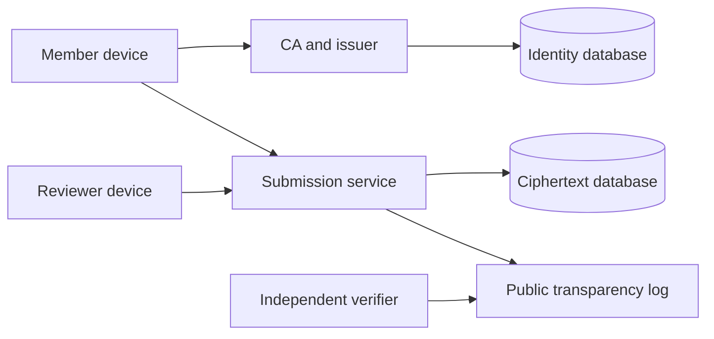

<!-- SPDX-FileCopyrightText: 2026 Anonce Contributors -->
<!-- SPDX-License-Identifier: AGPL-3.0-only -->

# Architecture

Audience: implementers, reviewers, and operators evaluating system boundaries.

Status: the default [browser application](deployment.md#browser-mvp-local-startup) connects
accounts, encrypted member backups, enrollment, rounds, issuance, anonymous
acceptance and local review. The sections marked proposed describe the broader
product, not additional MVP guarantees. The original local HTTP services and shell
remain independently available without these routes.

Shared key/session/store packages remain transport-independent. The browser hosts
compose them without changing the original demonstration commands. Protected
signing custody, recovery, transparency and broader product policy remain proposed.

## Components and ownership

| Component | Holds | Must not receive |
| --- | --- | --- |
| Membership CA and enrollment | Cohorts, enrollment-code digests, CSRs, certificates, revocation state | Member private keys |
| Identity account and vault service | Account credentials/sessions, eligibility dashboard, encrypted member-key backups | Plaintext device keys, vault unlock secrets, PRF outputs, submission history or reply capabilities |
| Token issuer | Certificate authentication, cohort eligibility, per-member/round quota ledger and private reservation slots | Unblinded tokens or submission content |
| Submission service | Round bulletins, anonymous tokens during validation, spent-token digests, ciphertext | Member identity, issuer sessions, private keys, plaintext answers |
| Reviewer client | Round private keys, locally decrypted answers, reply content | Enrollment identities |
| Member client | Member keystore, token state, answers, receipt and reply secret | CA or issuer private keys |
| Public transparency log | Commitments, checkpoints, proofs, public artifact hashes | Identity records, bearer tokens, private replies |
| Administrative audit service | Authorized actions and non-secret outcomes | Submission bodies, token values, private key material |

- CA and issuer may share an identity-side deployment, but not signing keys or permissions.
- Submission runs separately and must not import identity persistence packages.
- Reviewers decrypt on their devices, not through a server-side plaintext endpoint.

## Trust boundaries

Identity and ciphertext storage use independent PostgreSQL instances. See
[database](database.md) for schema and privileges, and [deployment](deployment.md)
for network, credential, backup, and metadata separation.

## Client and server contract

- The product is browser-only for every role. Accounts, shared review links, and
  automatic key setup follow [the user workflow](ui-design.md#account-and-review-workflow).
  Installation and manual key/file management are not prerequisites.
- Go serves embedded HTML templates, CSS, ES modules, fonts, and the compiled browser client.
- Browser workers use shared device-side Go cryptographic composition. Offline
  key diagnostics reuse those packages only as developer tooling, not a user workflow.
- Submission and reply handlers receive ciphertext only.
- Result pages render decrypted data locally, never on the server.

Signed bulletins bind the form, schedule, per-member response limit, round encryption
key, token-verifier key, and profile. Clients must validate the bulletin and compare
a trusted checkpoint or independent copy. Signatures alone cannot detect different
validly signed forms served to different members.

## Account and anonymous flow

### Implemented browser MVP boundary

`browser-identity` opens only the identity runtime database. `browser-submission`
opens only the independent submission runtime database and imports no identity
persistence. The original demonstration commands do not change behavior.
Browser paths use the explicit `/api/browser/` namespace, not the unavailable
`/api/v1/` protocol proposal.

The anonymous page prepares blind state in its own Go worker, opens the configured
identity origin with a common round ID, and exchanges only a bounded blinded
request and blind signature. Both contexts validate exact sender origin and window,
message keys, round, and byte lengths. There is no wildcard messaging, token URL,
CORS credential sharing or account call from the anonymous page. Identity-side
member signing checks the signed bulletin and blinded-request hash in shared Go.
The account popup performs explicit local unlocking and issuance consent.

The anonymous worker finalizes the signature, pads/encrypts one answer, and verifies
the [signed storage acceptance](cryptography.md#browser-mvp-profile-1). Tokens,
answers, retry payloads and receipts remain anonymous-page memory, not the account
vault. Closing/reloading/expiry loses this state; issuance has no refund. The
identity service sees issuance participation and timing, not an acceptance index.

Review uses a round-scoped proof of X25519 decryption, not identity cookies, at the
submission interface. The assigned reviewer's encrypted backup is kept only in
its identity-side browser database. Server ciphertext access expires at the signed
review deadline. Previously obtained keys/plaintext/ciphertext cannot be recalled.
Publication signatures use a configured trust key, without independent checkpoint
or split-view detection. These are explicit MVP limitations.

The identity origin owns sign-in, enrollment, the eligible-round dashboard, and
the [encrypted member-key vault](key-management.md#browser-account-vault).
Authentication, local unlocking, and membership proof for issuance are separate
checks. An account or passkey is not a replacement for the membership certificate
or blind authorization token.

The member opens a common round link or dashboard entry. The browser obtains
authorization on the identity side, then submits token and ciphertext through
the separate anonymous origin. Only the minimal anonymous round-scoped material
may cross that boundary. Member keys, certificates, accounts, credential IDs,
vault IDs, quota slots, and login sessions must not cross it.

Anonymous pages must not call the account/vault service or load identity-personalized
assets. Receipt and reply state stays in the anonymous context, not an account
history. A dashboard lists eligible rounds, not server-confirmed per-account
submissions. Neither browser vault restoration nor login restores anonymous
receipt/reply state by implication.

Before browser integration, specify and test the cross-origin handoff, key ownership
per context, cancellation/replay behavior, navigation return targets, and requests
without identity credentials. Do not put tokens or secrets in URL paths, queries,
or fragments.
If messaging is used, require exact sender/receiver origin and window validation
with bounded typed messages. This is an open design, not permission to bridge
origins using wildcard CORS or membership cookies.

Reviewers use a distinct authorized browser context for ciphertext retrieval and
local decryption. Their keys remain round-scoped; account sign-in does not grant
universal decrypt access. Reviewer authorization and backup retention still need
the [protocol design](protocol.md#review-and-replies).

## Package boundaries

| Location | Responsibility |
| --- | --- |
| `cmd/server`, `cmd/issuer`, `cmd/ca` | Process configuration and lifecycle |
| `internal/app`, `internal/service` | Implemented command configuration, bounded local HTTP, and unavailable-operation responses |
| `cmd/migrate`, `internal/dbmigrate` | Operator-only embedded Goose runner for separate local histories |
| `internal/identity/accounts` | Implemented runtime-role account/session persistence; no credentials, HTTP, membership, or vault integration |
| `internal/identity/memberbackup` | Internal encrypted member-backup slots, fixed public binding, revisions and deletion tombstones; no authentication, HTTP, browser, enrollment, PRF, or recovery integration |
| `cmd/client`, `internal/clientcli` | Implemented offline key CLI and file custody |
| `cmd/wasm`, `internal/clientwasm` | Implemented public-only member-request verifier; no page integration or device-key access |
| `cmd/memberwasm`, `internal/memberwasm` | Separate local WASM adapter for shared member sessions; no page host, accounts, or storage |
| `internal/memberworker` | Local dedicated-worker owner, bounded correlated transport, fixed lifetime, and terminal disposal; no HTTP/page integration or cross-tab coordination |
| `cmd/cli` | Optional future protocol CLI, not required for product use |
| `internal/client` | Shared composition, validation, and local state |
| `internal/client/keystore` | Implemented in-memory device-backup encryption; no transport or persistence |
| `internal/client/memberkey` | Implemented local Ed25519 member-key generation and typed encrypted backups; no transport or persistence |
| `internal/client/membercsr` | Implemented local, identity-free member certificate requests and bounded validation; no enrollment or transport |
| `internal/client/membersession` | Implemented in-memory member setup, expected-key restoration, fixed CSR requests, and lock; no account binding or persistence |
| `internal/client/reviewerkey` | Implemented local X25519 reviewer-key generation and typed encrypted backups; no transport, persistence, or round binding |
| `internal/membership`, `internal/issuer` | Identity-side policy and issuance |
| `internal/submission` | Ciphertext acceptance and atomic spending |
| `internal/transparency`, `internal/audit` | Distinct public and administrative logs |
| `internal/web`, `web/` | Templates, self-hosted assets, and UI composition |
| `migrations/identity`, `migrations/submission` | Implemented independent SQL histories; identity account/session/member-backup tables and separate boundary markers |

- Use the standard library for HTTP, templates, embedding, and cryptography where
  it meets the reviewed profile.
- Use native pgx pools with cancellation and separately applied Goose SQL migrations.
  See [dependencies](dependencies.md) for versions and licenses.
- Domain code must not depend on HTTP handlers. Clients must not import server
  storage or database drivers. No command may silently connect to both databases.

Current implementation limits:

- The [local Compose stack](deployment.md#container-stack) supplies independent
  PostgreSQL instances and role/schema bootstrap. Separate migrations and an internal
  identity account/session and encrypted member-backup stores exist. No HTTP database integration or
  membership/issuance/submission domain packages exist.
- `internal/web` pre-renders fixed pages at startup using escaped templates and
  first-party CSS embedded in `web/`. Request data never enters templates.
  Only the submission service serves these pages; they load no executable browser code.
- The offline CLI uses the shared key packages; HTTP services do not import them.
  See [cryptography](cryptography.md#keystore-composition) for their profiles and limits.
- The separate [WASM artifact](key-management.md#local-wasm-request-verification)
  shares member-request validation with the CLI. No HTTP service serves it.
- The separate [member WASM adapter](key-management.md#local-wasm-member-sessions)
  owns one shared session with bounded inputs and public/encrypted outputs. It adds
  no account, browser page, or persistence. The separate
  [worker owner](key-management.md#local-member-worker-host) adds a local bounded
  transport and terminable execution context, not HTTP delivery or account custody.

## Availability and failure

- Liveness is dependency-independent; readiness checks the service's own database
  and migration version.
- Fail closed on unknown profiles, stale required revocation data, invalid signatures,
  or untrusted round keys.
- Acceptance requires a durable spend and log commitment. Commit the spend, bound
  ciphertext, and publication outbox in one transaction.
- Recover pending log publication without reopening tokens. Retries cannot replace
  accepted payloads. Resolve remaining recovery rules before implementation.

## Administrative access

| Role | Responsibilities | Exclusions |
| --- | --- | --- |
| Super admin | CA initialization, admin accounts, role and system policy | Reviewer keys and plaintext submissions |
| Round manager | Assigned cohorts, enrollment, forms, draft response limits, and round scheduling | CA key export, reviewer decryption, role escalation |
| Auditor | Authorized audit records, public trust state, checkpoints | Write actions and unrestricted member material |
| Reviewer | Local decryption of assigned rounds, replies, abuse flags | Member directory and enrollment delivery data |
| Member | Enrollment, eligible issuance, submission, verification, replies | Administrative operations |

- Authorize every object and operation server-side. Hidden buttons and dialogs
  are not access controls.
- Use Argon2id passwords, passkeys with reviewed TOTP fallback/recovery, protected
  and rotated server-side sessions with explicit expiry, CSRF validation, rate
  limits, bounded lockout, and durable audit events.
- Recovery must not bypass the stronger factor. CA initialization, revocation,
  and key destruction require recent reauthentication.
- Audit initialization, enrollment/import, revocation, role changes, response-limit
  configuration, round publication, and destruction.
- Record only authorized actor/role, target, action, outcome, and retention context.
  Anchor commitments externally. Test removed, reordered, and modified events.

The [threat model](threat-model.md) defines the limits of operational separation.
