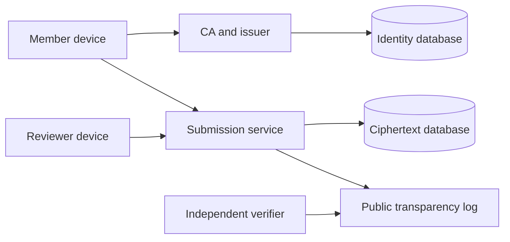

<!-- SPDX-FileCopyrightText: 2026 Anonce Contributors -->
<!-- SPDX-License-Identifier: AGPL-3.0-only -->

# Architecture

Audience: implementers, reviewers, and operators evaluating system boundaries.

Status: proposed application architecture. Local HTTP infrastructure, a read-only
web shell, shared device-backup encryption, and local member-key generation and
encrypted import/export exist. No domain policy, device entry points, storage,
or working submission protocol.

## Components and ownership

| Component | Holds | Must not receive |
| --- | --- | --- |
| Membership CA and enrollment | Cohorts, enrollment-code digests, CSRs, certificates, revocation state | Member private keys |
| Token issuer | Certificate authentication, cohort eligibility, per-member/round quota ledger and private reservation slots | Unblinded tokens or submission content |
| Submission service | Round bulletins, anonymous tokens during validation, spent-token digests, ciphertext | Member identity, issuer sessions, private keys, plaintext answers |
| Reviewer client | Round private keys, locally decrypted answers, reply content | Enrollment identities |
| Member client | Member keystore, token state, answers, receipt and reply secret | CA or issuer private keys |
| Public transparency log | Commitments, checkpoints, proofs, public artifact hashes | Identity records, bearer tokens, private replies |
| Administrative audit service | Authorized actions and non-secret outcomes | Submission bodies, token values, private key material |

- CA and issuer may share an identity-side deployment, but not signing keys or permissions.
- Submission runs separately and must not import identity persistence packages.
- Reviewers decrypt on their devices, not through a server-side plaintext endpoint.

## Trust boundaries

Identity and ciphertext storage use independent PostgreSQL instances. See
[database](database.md) for schema and privileges, and [deployment](deployment.md)
for network, credential, backup, and metadata separation.

## Client and server contract

- Go serves embedded HTML templates, CSS, ES modules, fonts, and the compiled browser client.
- CLI and WASM share device-side Go cryptographic composition.
- Submission and reply handlers receive ciphertext only.
- Result pages render decrypted data locally, never on the server.

Signed bulletins bind the form, schedule, per-member response limit, round encryption
key, token-verifier key, and profile. Clients must validate the bulletin and compare
a trusted checkpoint or independent copy. Signatures alone cannot detect different
validly signed forms served to different members.

## Package boundaries

| Location | Responsibility |
| --- | --- |
| `cmd/server`, `cmd/issuer`, `cmd/ca` | Process configuration and lifecycle |
| `internal/app`, `internal/service` | Implemented command configuration, bounded local HTTP, and unavailable-operation responses |
| `cmd/cli`, `cmd/wasm` | Device-side entry points |
| `internal/client` | Shared composition, validation, and local state |
| `internal/client/keystore` | Implemented in-memory device-backup encryption; no transport or persistence |
| `internal/client/memberkey` | Implemented local Ed25519 member-key generation and typed encrypted backups; no transport or persistence |
| `internal/membership`, `internal/issuer` | Identity-side policy and issuance |
| `internal/submission` | Ciphertext acceptance and atomic spending |
| `internal/transparency`, `internal/audit` | Distinct public and administrative logs |
| `internal/web`, `web/` | Templates, self-hosted assets, and UI composition |
| `migrations/issuer`, `migrations/submission` | Independently applied SQL histories |

- Use the standard library for HTTP, templates, embedding, and cryptography where
  it meets the reviewed profile.
- Use native pgx pools with cancellation and separately applied Goose SQL migrations.
  See [dependencies](dependencies.md) for versions and licenses.
- Domain code must not depend on HTTP handlers. Clients must not import server
  storage or database drivers. No command may silently connect to both databases.

**Current implementation:** no databases or membership/issuance/submission domain
packages. `internal/web`
pre-renders fixed pages at startup using escaped templates and first-party CSS
embedded in `web/`. Request data never enters templates. Only submission serves
these pages; there is no executable browser code or device entry point. The
shared keystore and member-key packages are not imported by HTTP services. Their
profiles and limits are defined in [cryptography](cryptography.md#keystore-composition).

## Availability and failure

- Liveness is dependency-independent; readiness checks the service's own database
  and migration version.
- Fail closed on unknown profiles, stale required revocation data, invalid signatures,
  or untrusted round keys.
- Acceptance requires a durable spend and log commitment. Commit the spend, bound
  ciphertext, and publication outbox in one transaction.
- Recover pending log publication without reopening tokens. Retries cannot replace
  accepted payloads. Resolve remaining recovery rules before implementation.

## Administrative access

| Role | Responsibilities | Exclusions |
| --- | --- | --- |
| Super admin | CA initialization, admin accounts, role and system policy | Reviewer keys and plaintext submissions |
| Round manager | Assigned cohorts, enrollment, forms, draft response limits, and round scheduling | CA key export, reviewer decryption, role escalation |
| Auditor | Authorized audit records, public trust state, checkpoints | Write actions and unrestricted member material |
| Reviewer | Local decryption of assigned rounds, replies, abuse flags | Member directory and enrollment delivery data |
| Member | Enrollment, eligible issuance, submission, verification, replies | Administrative operations |

- Authorize every object and operation server-side. Hidden buttons and dialogs
  are not access controls.
- Use Argon2id passwords, passkeys with reviewed TOTP fallback/recovery, protected
  and rotated server-side sessions with explicit expiry, CSRF validation, rate
  limits, bounded lockout, and durable audit events.
- Recovery must not bypass the stronger factor. CA initialization, revocation,
  and key destruction require recent reauthentication.
- Audit initialization, enrollment/import, revocation, role changes, response-limit
  configuration, round publication, and destruction.
- Record only authorized actor/role, target, action, outcome, and retention context.
  Anchor commitments externally. Test removed, reordered, and modified events.

The [threat model](threat-model.md) defines the limits of operational separation.
