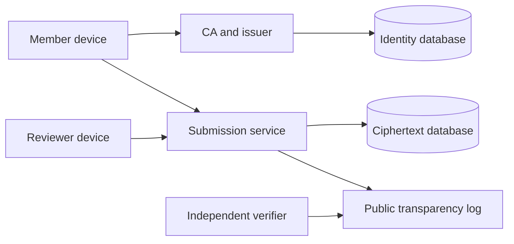

<!-- SPDX-FileCopyrightText: 2026 Anonce Contributors -->
<!-- SPDX-License-Identifier: AGPL-3.0-only -->

# Architecture

Audience: implementers, reviewers, and operators evaluating system boundaries.

Status: application architecture is proposed. Local HTTP infrastructure is
implemented alongside a read-only web shell; domain policy, device clients,
persistence, and cryptography are absent.

## Components and ownership

| Component | Holds | Must not receive |
| --- | --- | --- |
| Membership CA and enrollment | Cohorts, enrollment-code digests, CSRs, certificates, revocation state | Member private keys |
| Token issuer | Certificate authentication, cohort eligibility, per-member/round quota ledger and private reservation slots | Unblinded tokens or submission content |
| Submission service | Round bulletins, anonymous tokens during validation, spent-token digests, ciphertext | Member identity, issuer sessions, private keys, plaintext answers |
| Reviewer client | Round private keys, locally decrypted answers, reply content | Enrollment identities |
| Member client | Member keystore, token state, answers, receipt and reply secret | CA or issuer private keys |
| Public transparency log | Commitments, checkpoints, proofs, public artifact hashes | Identity records, bearer tokens, private replies |
| Administrative audit service | Authorized actions and non-secret outcomes | Submission bodies, token values, private key material |

The issuer and CA may share the identity-side administrative deployment, but their
signing keys and permissions remain distinct. The submission service runs separately
and never imports identity persistence packages. A reviewer is a device-side role,
not a server that receives plaintext through a results endpoint.

## Trust boundaries

Identity and ciphertext storage use independent PostgreSQL instances. See
[database](database.md) for schema and privileges, and [deployment](deployment.md)
for network, credential, backup, and metadata separation.

## Client and server contract

Go serves embedded HTML templates, CSS, ES modules, fonts, and the compiled browser
client. Shared device-side Go packages implement the future cryptographic composition
for the CLI and WASM. HTTP handlers only receive ciphertext for submissions and
replies. HTML result pages are containers for local rendering, never decrypted
server-rendered reports.

Signed round bulletins bind the form, schedule, administrator-set per-member response
limit, round encryption key, token-verifier key, and protocol profile. Clients must
validate the bulletin and compare a trusted checkpoint or independent copy. A valid
signature alone cannot detect a dishonest
publisher serving different signed forms to different people.

## Package boundaries

| Location | Responsibility |
| --- | --- |
| `cmd/server`, `cmd/issuer`, `cmd/ca` | Process configuration and lifecycle |
| `internal/app`, `internal/service` | Implemented command configuration, bounded local HTTP, and unavailable-operation responses |
| `cmd/cli`, `cmd/wasm` | Device-side entry points |
| `internal/client` | Shared composition, validation, and local state |
| `internal/membership`, `internal/issuer` | Identity-side policy and issuance |
| `internal/submission` | Ciphertext acceptance and atomic spending |
| `internal/transparency`, `internal/audit` | Distinct public and administrative logs |
| `internal/web`, `web/` | Templates, self-hosted assets, and UI composition |
| `migrations/issuer`, `migrations/submission` | Independently applied SQL histories |

Use the Go standard library for HTTP, templates, embedding, and cryptography where
it meets the reviewed profile. Use native pgx pools with cancellation for database
access and Goose for separately applied SQL migrations. Versions and licenses are
listed in [dependencies](dependencies.md).

Domain code must not depend on HTTP handlers. Client packages must not import server
storage or database drivers. No command may silently connect to both databases.
The current processes connect to neither database and do not contain domain packages.
The implemented shell uses escaped Go templates and first-party CSS embedded in
`web/`. `internal/web` pre-renders fixed public pages at startup; request data is
never passed into templates. Only the submission process exposes these pages.
There is no executable browser code or device-side client yet.

## Availability and failure

Keep liveness independent of dependencies and readiness dependent on the service's
own database and migration version. Fail closed for unknown profiles, stale required
revocation data, invalid signatures, or untrusted round keys. A submission is accepted
only with a durable spend and log commitment; crash recovery must reconcile pending
log publication without reopening the token. Spending, bound ciphertext, and the
publication outbox commit in one database transaction. A retry must not replace the
accepted payload. Resolve the remaining recovery rules before implementation.

## Administrative access

| Role | Responsibilities | Exclusions |
| --- | --- | --- |
| Super admin | CA initialization, admin accounts, role and system policy | Reviewer keys and plaintext submissions |
| Round manager | Assigned cohorts, enrollment, forms, draft response limits, and round scheduling | CA key export, reviewer decryption, role escalation |
| Auditor | Authorized audit records, public trust state, checkpoints | Write actions and unrestricted member material |
| Reviewer | Local decryption of assigned rounds, replies, abuse flags | Member directory and enrollment delivery data |
| Member | Enrollment, eligible issuance, submission, verification, replies | Administrative operations |

Authorize each object and operation server-side. Use Argon2id passwords, passkeys
with reviewed TOTP fallback/recovery, protected and rotated server-side sessions
with explicit expiry, CSRF validation, rate limits, bounded lockout, and durable
audit events. Recovery must not bypass the stronger factor. CA initialization,
revocation, and key destruction require recent
reauthentication. Hidden buttons and confirmation dialogs are not access controls.

Audit initialization, enrollment/import, revocation, role changes, response-limit
configuration and round publication, and destruction.
Record only the authorized actor/role, target, action, outcome, and retention context,
with externally anchored commitments. Test removed, reordered, and modified events.

The [threat model](threat-model.md) defines the limits of operational separation.
