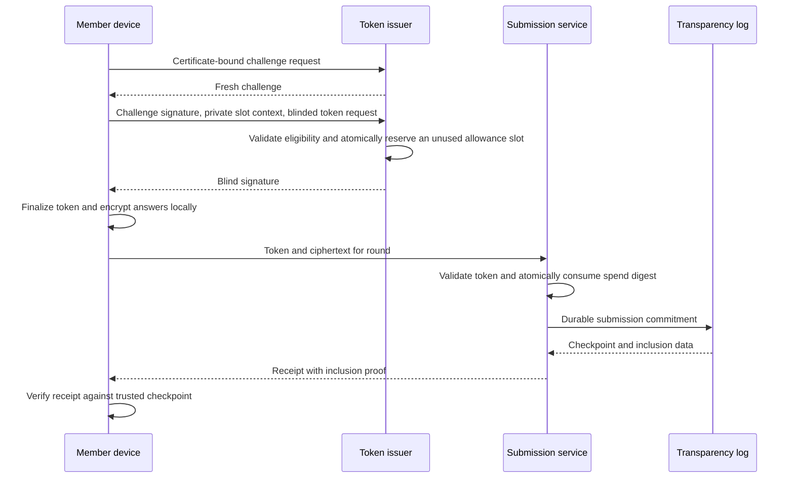
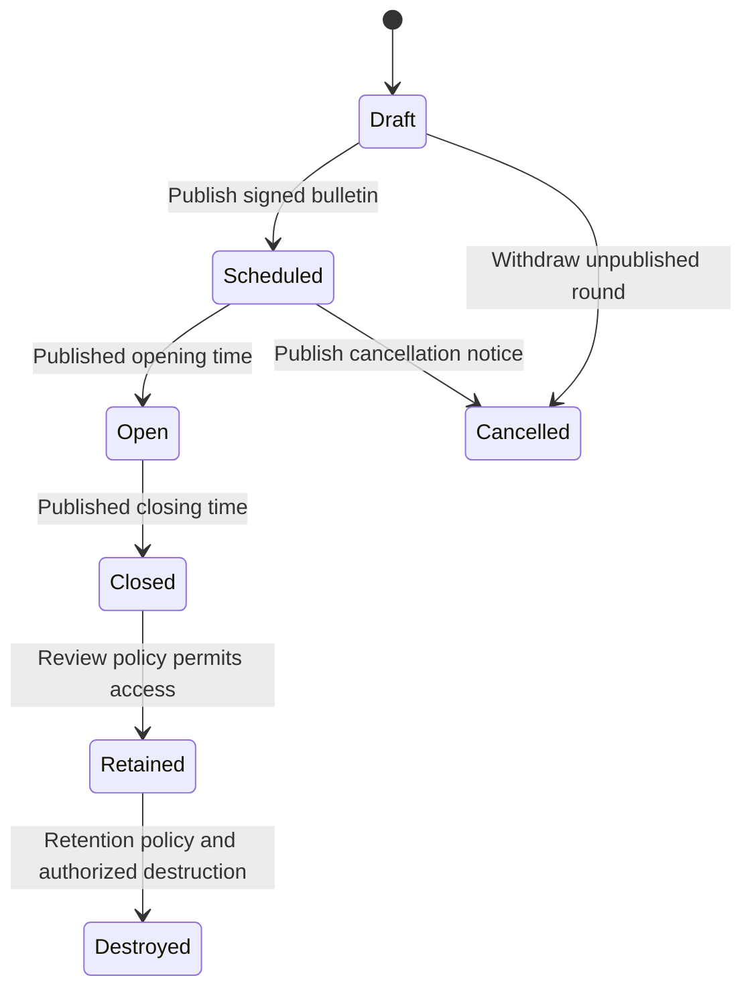

<!-- SPDX-FileCopyrightText: 2026 Anonce Contributors -->
<!-- SPDX-License-Identifier: AGPL-3.0-only -->

# Protocol design

Audience: protocol implementers and security reviewers.

Status: the default browser services implement
[browser MVP profile 1](cryptography.md#browser-mvp-profile-1), not a stable released
wire format. Its single-text, single-reviewer, explicit-one-response contract
defines the implemented `/api/browser/` transport. Broader requirements below are
planned unless identified as part of that profile.
The internal
[submission record store](database.md#implemented-submission-record-storage) provides
atomic persistence and exact-ciphertext retries for already verified inputs, not
protocol verification. Browser handlers verify inputs before calling that store.

## Enrollment and authentication

1. The manager creates a cohort and unpredictable, expiring, single-use codes.
   The member creates/signs in to an identity-side account; login alone does not
   prove eligibility.
2. The browser automatically generates the member key and CSR locally and prepares
   the encrypted member-key backup under the [vault contract](key-management.md#browser-account-vault).
   No manual key commands or CSR/file handling are user steps.
3. The CA checks proof of possession, code use, membership, and CSR policy, then
   issues a certificate and atomically consumes the code. Retain no raw code after delivery.

Enrollment controls:

- Automatic [member request generation](key-management.md#in-memory-member-sessions)
  feeds the browser enrollment transaction, which authenticates the account and
  consumes a single-use invitation. A request signature alone grants no authority.
- Bound and rate-limit attempts without revealing enrollment status.
- Imports: minimal columns, bounded CSV parsing, duplicate/error preview, transactional writes.
- Delivery: private printing; optional identity-side SMTP without raw-code logging.
- Regeneration: atomically invalidate the old unused code without changing eligibility
  or permitting concurrent reuse.
- Revocation: record a reason, require recent reauthentication, publish fresh signed revocations.

Token authentication requires a fresh, bounded-lifetime challenge bound to issuer,
round, certificate, and operation. Check signature, chain, expiry, revocation, cohort,
schedule, and issuance eligibility. Consumed challenges cannot be replayed.
Credentials must never reach the submission origin.

### Account and review-link integration

Follow the [browser workflow](ui-design.md#account-and-review-workflow): open a
common round link or dashboard entry, authenticate and unlock on the identity
side as needed, obtain eligible issuance, then encrypt and submit anonymously.
Do not replace certificate proof of possession with an account session or passkey
assertion. Account recovery, a new device, or key replacement cannot reset quota.

The [cross-origin handoff](architecture.md#account-and-anonymous-flow) must not
carry member/account identifiers, certificates, vault references, login credentials,
or personalized URL values into anonymous requests. It still needs a reviewed
transport and replay policy. No submission token is carried in a URL. Automatic
key custody is not permission to retain blind tokens or receipt/reply history
on the identity service. Replies remain anonymous capability operations.

## Round response limit

`response_limit` is the maximum responses each eligible member may authorize per
round, not a round-wide cap. `1` allows one response; larger values allow several.

- Require a positive integer in a documented, resource-bounded range. Reject missing,
  zero, negative, fractional, overflowing, or unsupported values. No unlimited mode.
- An authorized administrator sets the limit. The draft may suggest `1`, but
  publication requires explicit confirmation.
- Sign one common limit for all eligible members, without overrides. After
  publication, changes require a new round ID and independently scoped keys and authorization.
- Each response has an independent blind token, spend identity, ciphertext, receipt,
  and reply capability. Each token permits one submission.
- The issuer enforces the allowance. Submission must not learn identities to count responses.
- Reservation slots stay identity-side, never in anonymous requests, tokens,
  receipts, or public commitments.

The limit is not the result-release threshold. Response counts do not prove distinct
participation. See [threshold limits](threat-model.md#small-cohorts-and-content).

## Issuance and submission

**Issuer rules:**

- Store only identity-side quota usage and reservation status, never blinded or
  unblinded token transcripts or signatures.
- Bind the requested slot and common bulletin digest to the fresh authentication challenge.
- Reserve atomically before signing. Prevent duplicate reservation and quota overflow
  across slots, sessions, devices, and replacement certificates for one membership.
- Failed signing or delivery still consumes the reservation. No automatic refund
  or re-signing; other unreserved slots remain usable within the allowance.
- [Recovery is unresolved](roadmap.md#open-implementation-questions). It must not
  retain transcripts or create another usable token for a reserved slot. Clients
  must warn that interruption can reduce usable allowance.

**Submission rules:**

- Use round-scoped keys. Validate the expected key/profile, token structure, round
  window, size limits, and ciphertext envelope.
- Derive the spend digest from canonical token input, not signature bytes.
  Alternate signature representations must not permit another spend.
- Use database uniqueness to arbitrate concurrency. Accept distinct valid tokens
  in multi-response rounds, never a second submission with the same token.
- Never replace ciphertext under a consumed token. Returning an existing receipt
  on retry requires a documented payload-binding rule.

## Review and replies

- Reviewers retrieve ciphertext through an authorized interface and decrypt locally.
- Each encrypted answer envelope carries a fresh reply public key and unpredictable
  mailbox capability. Encrypt replies to that key.
- Define capability entropy, expiry, replay policy, and round-scoped write authorization
  before implementation. Mailbox queries must not use identity authentication or
  distinguishable errors.
- Keep exports local, spreadsheet-safe, and labelled with an identifying-content warning.
- Token blacklisting can block further interactions for that token. It cannot reveal
  a member, revoke their other issued tokens, or retract plaintext already seen.
- Flags/blocks require round-scoped reviewer authorization, reason categories,
  auditable changes, and explicit retention/appeal policies. Never query identity
  storage to resolve abuse. Review spent-token and mailbox-blocking semantics before implementation.

## Round state machine

- Support rating, choice, free-text, and ballot questions with accessible labels,
  instructions, validation, and previews.
- Bind round ID, cohort policy, versioned form digest, encryption/token keys, profile,
  schedule, `response_limit`, release threshold, and retention policy in the bulletin.
- Bound question count, text, options, nesting, and total form size. Reject unknown
  versions. Do not personalize forms or keys.
- Opening/closing cannot silently change the signed schedule. Bulletin changes require
  an explicit revision, client validation, and compatibility policy.
- Cancelled rounds reject submissions. Routine backups must not restore destroyed
  round keys; device exports remain an operator/reviewer limitation.

## Cryptographic and wire decisions

### Browser MVP decisions

The [profile](cryptography.md#browser-mvp-profile-1) fixes encodings, purposes,
bindings, lengths and failure behavior before wire processing. Eligibility is an
administrator-delivered, 24-hour, single-use invitation, verified CSR possession,
fixed encrypted-backup public binding and a current online membership record.
Registration alone grants neither membership nor reviewer assignment.

The MVP has one common eligibility scope: every active verified membership may
authorize each open round. Cohort-specific eligibility and revocation administration
remain excluded. Administrators must privately deliver at most one invitation per
eligible person; account registration does not verify a real-world person.

One published common bulletin binds one UTF-8 question, one round reviewer key,
the explicit response limit of one, schedule, review expiry, blind-RSA key and
receipt key. Published values cannot be edited. The identity ledger's unique
membership/round reservation commits before signing. Failure or loss after that
point consumes the allowance. There is no issuance replay/refund/re-sign endpoint.
Enrollment, another login and backup restoration cannot reset that ledger.

Anonymous acceptance verifies the complete blind token and envelope syntax before
calling the existing atomic record store. It cannot verify encrypted answer
contents; the reviewer rejects invalid authenticated plaintext locally. Exact
open-round retries receive the same signed acceptance. Different envelopes conflict,
and closure/cancellation denies even exact retries. There is no post-close recovery
endpoint. A signed acceptance attests committed storage, not public-log inclusion.

Reviewer reads prove possession of a round key by returning a decrypted random
challenge. Each proof is short-lived, one-use and cursor-bound; reads return at most
50 records without member/account/session metadata or precise acceptance times.
There is no server decryption endpoint. Replies and release thresholds are excluded.

See [cryptography](cryptography.md) for profiles and [API](api.md) for HTTP behavior.
Review and fix profile IDs, maximum lengths, canonical encoding, domain separation,
and version negotiation before wire code. These examples do not authorize new constructions.
