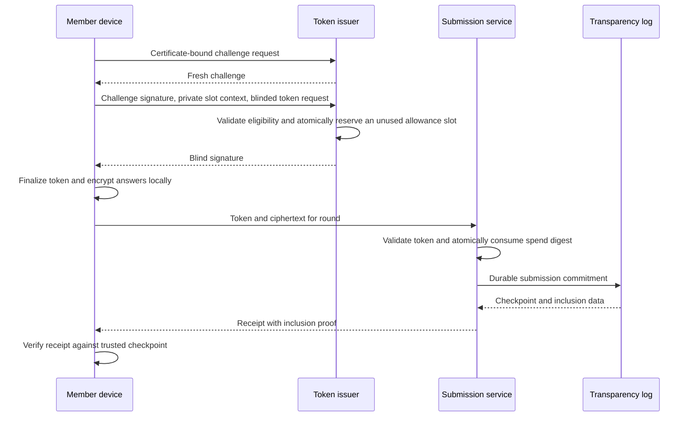
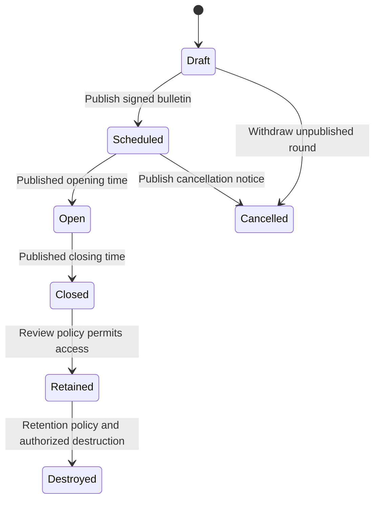

<!-- SPDX-FileCopyrightText: 2026 Anonce Contributors -->
<!-- SPDX-License-Identifier: AGPL-3.0-only -->

# Protocol design

Audience: protocol implementers and security reviewers.

Status: design only. Field names below communicate intent, not a frozen wire format.
All protocol APIs remain unimplemented and must reject rather than simulate success.

## Enrollment and authentication

The manager creates a cohort and unpredictable, expiring, single-use enrollment
codes. The member device generates its key and CSR locally. The CA validates proof
of possession, code use, membership, and CSR policy before issuing a certificate.
Codes are consumed atomically; raw codes are not retained after delivery. The device
may export an encrypted backup.
Bound and rate-limit enrollment attempts without revealing whether an identity is
enrolled. Cohort imports use minimal columns, bounded CSV parsing, duplicate/error
preview, and transactional writes. Printed delivery is private; optional SMTP
remains identity-side and must not log raw codes.
Regenerating a code must atomically invalidate the old unused code without changing
the member's eligibility or allowing concurrent reuse. Certificate revocation needs
a recorded reason, recent reauthentication, and fresh signed revocation publication.

Token authentication uses a fresh, bounded-lifetime challenge bound to the issuer,
round, certificate, and requested operation. The issuer checks signature, chain,
expiry, revocation, cohort, schedule, and issuance eligibility. A consumed challenge
cannot be replayed. Authentication credentials never reach the submission origin.

## Round response limit

An authorized administrator sets `response_limit`, the maximum number of responses
each eligible member may authorize in that round. A value of `1` supports a
single-response ballot; a larger value allows multiple responses. This is not a
round-wide response cap. The limit is a positive integer within a documented,
resource-bounded supported range. Reject missing, zero, negative, fractional,
overflowing, or unsupported values. There is no unlimited mode.

The draft UI may suggest `1`, but publication requires explicit administrator
confirmation. Publish one common signed limit for all eligible members. Do not use
per-member overrides. The limit is immutable after publication under that round ID;
changing it requires a new round ID and independently scoped keys and authorization.

Each permitted response uses an independent blind token, spend identity, ciphertext,
receipt, and reply capability. Tokens remain single-use. The issuer caps issuance
at the published allowance; the submission service never learns a member identity
to count that person's responses. Reservation slots exist only on the identity side
and must not appear in anonymous requests, tokens, receipts, or public commitments.

The response limit is distinct from the minimum response threshold for releasing
results. Multiple responses do not establish participation by distinct members. See
the [threshold limits](threat-model.md#small-cohorts-and-content).

## Issuance and submission

Issuance stores only identity-side quota usage and reservation status, never blinded
or unblinded token transcripts or their signatures. A fresh challenge binds the
requested slot and common bulletin digest as well as the authentication context.
Reserve a slot atomically before signing; concurrent requests must not reserve it
twice or exceed the published limit across slots, sessions, devices, or replacement
certificates for the same membership record.

A reservation consumes allowance even if signing or delivery fails. Lost responses
must not trigger automatic refunds or another signing operation for that slot.
Members may use other unreserved slots within the published allowance. Safe recovery
remains an [open question](roadmap.md#open-implementation-questions): it must neither
retain token transcripts nor produce another usable token for an already-reserved
slot. The client must explain that interruption can reduce the usable allowance.

Round-scoped keys prevent using a token authorized for one round in another. The
submission service validates the expected key and profile, token structure, round
window, size limits, and ciphertext envelope. The spend digest is derived from the
canonical token input, not its signature bytes, so alternate signature representations
cannot create another spend. Database uniqueness must arbitrate concurrent requests.
Accept several distinct valid tokens for a multi-response round, but never a second
submission under the same token.

Whether a retry returns an existing receipt requires a documented payload-binding
rule. The server must never accept a replacement ciphertext under a consumed token.

## Review and replies

The reviewer downloads ciphertext only through the authorized review interface,
then decrypts locally. The encrypted answer envelope contains a fresh reply public
key and unpredictable mailbox capability. Replies are encrypted to that key. Define
capability entropy, expiry, replay policy, and round-scoped write authorization
before implementation. Mailbox queries must avoid identity authentication and
distinguishable error behavior. Exports remain local and need spreadsheet-safe
handling and a warning about identifying content.

Token blacklisting can block further anonymous interactions associated with an
abusive token. It cannot reveal the member, revoke a person's already-issued tokens,
or retroactively retract plaintext seen by a reviewer.
Flags and blocking are round-scoped, require reviewer authorization, record a reason
category and auditable changes, and follow explicit retention and appeal policies.
Do not query the member directory or identity database to resolve abuse. Review
already-spent-token and mailbox-blocking semantics before implementation.

## Round state machine

Support rating, choice, free-text, and ballot questions with accessible labels,
instructions, validation, and previews. The bulletin binds the round ID, cohort
policy, versioned form digest, encryption and token keys, profile, schedule,
`response_limit`, release threshold, and retention policy. Forms bound question
count, text, options, nesting, and total size; unknown versions fail closed. Do not
personalize forms or keys for individual members.

Open and close operations cannot silently change the signed schedule. Bulletin
changes need an explicit revision, client validation, and a compatibility policy.
Cancelled rounds cannot accept submissions. Destroyed round keys cannot be restored
from routine server backups; device exports remain an operator/reviewer limitation.

## Cryptographic and wire decisions

The [cryptography reference](cryptography.md) owns algorithm profiles. The
[API reference](api.md) owns HTTP behavior. Profile identifiers, maximum lengths,
canonical encoding, domain separation, and version negotiation must be fixed through
review before interoperable wire code is written. No example here authorizes a new
cryptographic construction.
