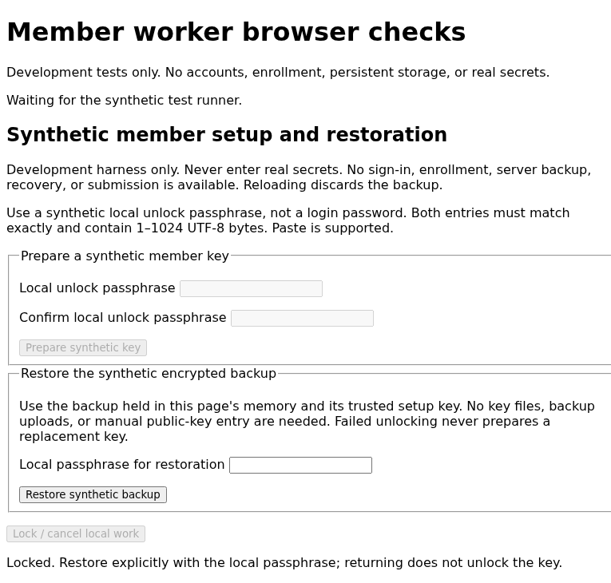

<!-- SPDX-FileCopyrightText: 2026 Anonce Contributors -->
<!-- SPDX-License-Identifier: AGPL-3.0-only -->

# Interface design system

Audience: front-end contributors, accessibility reviewers, and product reviewers.

Status: the original read-only shell and separate connected browser MVP forms are
implemented. The isolated member harness remains synthetic, not the account UI.
Broader product screens, product screenshots and manual accessibility evidence
remain outstanding.

## Account and review workflow

The product goal is: **sign in, open a review, submit**. All member, reviewer, and
administrator workflows must work in a supported browser without installing an
app, extension, CLI, or developer tools. Key generation, certificate requests,
encryption, and encrypted member-key backup are automatic browser operations,
not tasks assigned to users.

| Situation | Required experience |
| --- | --- |
| First visit | Create/sign in to an account, verify membership through the enrollment flow, and let the browser prepare keys and encrypted backup |
| Shared review link | Show common round information, sign in on the identity origin if needed, then return to the selected round without repeating navigation |
| Member dashboard | List eligible available rounds and public schedules, with a clear action to open each form |
| Submit | Complete an accessible form, confirm, encrypt locally, send anonymously, and verify the receipt locally |
| Return visit | Reuse an unlocked session where safe; avoid repeated key prompts for each form action |
| Another device | Sign in and restore the encrypted member-key backup through a supported local unlock method, without copying key files |
| Recovery | Explain whether account access, encrypted keys, or both can be restored and what remains inaccessible |
| Reviewer/admin | Browser dashboards with role-scoped access; reviewer keys are prepared automatically per round and answers decrypt locally |

Account creation alone does not establish eligibility. Preserve enrollment checks,
published response limits, explicit submission consent, and the
[identity/anonymous boundary](architecture.md#account-and-anonymous-flow).
Shared review URLs identify a common round, not a member, tracking code, or bearer
token. Invitations carrying enrollment secrets stop at the identity origin.

The identity dashboard must not store which submission belongs to an account or
poll anonymous receipts/mailboxes using account credentials. Receipt and reply
views belong to the anonymous browser context; cross-device access to those views
is not promised by restoring the member-key backup.

Use passkey sign-in as the preferred account experience. Where supported and
reviewed, combine it with local vault unlocking. Otherwise present a plain-language
browser unlock step, not manual key generation or an instruction to install the
CLI. Follow the [vault decision and recovery limits](key-management.md#browser-account-vault).
Do not label successful login as successful restoration until local decryption
and key validation succeed.

Support password-manager autofill and paste for any passphrase fields. Provide
accessible progress, cancellation, safe errors, and a way to lock/sign out. Warn
before lock/expiry can discard an unsent answer; do not save plaintext drafts on
the server. Shared-device sessions must not persist unlocked secrets or silently
enable remember-device storage. Browser compatibility and these UX paths require
[real browser evidence](testing.md#browser-account-and-vault-acceptance).

## Current local shell

### Connected browser MVP pages

The opt-in [browser hosts](deployment.md#browser-mvp-local-startup) add account,
local unlocking, enrollment, round/publication, anonymous free-text submission and
local reviewer forms. They are separate from the original read-only shell.

The anonymous origin collects and encrypts answers. Reviewer plaintext renders
locally with `textContent`, never HTML interpolation or a plaintext server API.
Labels, live status, disabled startup controls, independent passphrase confirmation,
explicit lock/cancel/sign-out, published limits, issuance-loss warnings and the
receipt-contract limitation are visible. Ordinary users do not handle keys, CSRs
or files. Reviewers are warned that their encrypted key stays in this browser.

An undecryptable answer gets a plain-language placeholder without hiding later
records or pages. The final status reports the number of rejected answers. Lock,
hidden-page state, round expiry, and reviewer-owner replacement stop reading
instead of being treated as bad answers; no late plaintext or success status is
displayed.

Replies, charts, generalized forms, credential/recovery management and advanced
administration remain excluded. Product screenshots, manual assistive-device,
contrast, mobile and autofill-provider review remain outstanding. The synthetic
screenshot below is not evidence of these connected pages.

- **Pages:** submission-only `/` and `/about`; `/dev/styleguide` requires
  `-dev-styleguide`. The guide has a synthetic draft, unavailable publication button,
  and empty/status examples, not administration.
- **Content:** no public mock response metrics, forms, private data, or scripts.
  Every page has a development warning, source footer, landmarks, and skip link.
- **Style:** original CSS/device fonts pending product-dependency review. Responsive
  layout, visible focus, system light/dark colors, print rules, no animation.
  See [deployment](deployment.md#transport-and-headers) for hashed CSS/SRI delivery.
- **Evidence:** `make web-lint` checks inert markup, fragments, links, hashes,
  CSS loading, headers, methods, and development gating. It does not validate full
  HTML/CSS, run browsers, measure contrast, establish WCAG conformance, or replace
  keyboard/assistive review. Actual desktop/mobile and light/dark screenshots plus
  browser/manual checks remain required; no substitute rendering images are provided.

## Synthetic member forms

The [opt-in browser harness](testing.md#member-worker-browser-checks) includes
test-only local setup and restoration forms. They are embedded only in test
binaries, never served by the demonstration commands or on the anonymous
submission service.

Two separately labelled passphrase fields use `autocomplete="new-password"`, allow
paste, and clear before awaiting worker startup. Shared Go confirms exact UTF-8
bytes before preparing the key, encrypted backup, and fixed request. A live status,
busy state, and keyboard-operable lock/cancel button expose progress without keys,
passphrases, or driver diagnostics. Controls start disabled until scripts mount.
No form control has a submission name; CSP prohibits native form submission.

Successful setup retains only encrypted/public material in page memory, with an
explicit nondurable-backup warning. Setup cannot overwrite an existing synthetic
backup. Reloading discards that material. Lock, disposal, visibility loss, and
observed worker closure clear fields and reject late results. Browser/runtime
copies and autofill cannot be reliably erased. Only synthetic inputs are permitted.

Restoration accepts one local passphrase with `autocomplete="current-password"`.
The fixed in-memory test adapter supplies the encrypted backup and expected public
key without file selection, key display, or manual public-key entry. The controller
snapshots the bounded 108-byte backup and 32-byte expected key before worker startup;
the worker uses shared Go for authenticated import and expected-key matching. The
expected key comes from the trusted setup output or an independently supplied fixture,
not from the ciphertext being restored. This does not settle product enrollment
binding or malicious-server rollback defense.

Wrong passwords, corrupted backups, and key substitution unlock nothing and never
call setup or replace the encrypted record. Setup stays unavailable while a backup
exists. Cancellation and backgrounding terminate the owner; returning merely
reenables explicit restoration. A second synthetic browser page can restore a
driver-supplied encrypted record using its independently retained expected key.
That fixture is not authentication, network vault access, persistence, or recovery.

The implementation follows the [HTML Living Standard forms model](https://html.spec.whatwg.org/multipage/forms.html)
(consulted 2026-10-29), not a new cryptographic profile. Automated Chromium checks
exercise Tab/Enter, labelled control names in the accessibility tree, mismatch
handling, field clearing, lock, and native validation of the resulting backup.
Restoration checks cover wrong passwords, expected-key substitution, ciphertext
corruption, startup cancellation, a separate page, and real background-tab locking.
These are not manual screen-reader, autofill-provider, mobile, or WCAG results.

Captured from the actual pinned Chromium harness on 2026-10-29. This is test UI,
not evidence of account authentication, enrollment, or durable backup. The stored
lossless grayscale PNG was verified to preserve every decoded RGBA pixel from the
capture.

## Visual language

Future product: Pico CSS 2.1.1, custom layout tokens, local Inter 4.1, selected
licensed SVG icons, and SVG charts. Server-render only public/mock charts;
render decrypted results on the reviewer device. Use calm surfaces, clear hierarchy,
and useful whitespace, not decorative security imagery.

| Token | Proposed value or rule |
| --- | --- |
| Primary | Indigo `#4338ca` in light mode; contrast-tested lighter variant in dark mode |
| Accent | Teal `#0f766e`; never the only indication of status |
| Surfaces | Light `#ffffff` / `#f5f7fb`; dark `#111827` / `#0b1020` |
| Text | Light `#172033`; dark `#eef2ff`; muted text needs separate contrast tests |
| Spacing | 4, 8, 12, 16, 24, 32, 48 CSS pixels |
| Typography | 1rem body with at least 1.5 line height; restrained 1.125/1.25/1.5/2rem headings |
| Shape | 8px controls, 12px cards; subtle borders rather than heavy shadows |
| Width | Readable prose at about 70 characters; responsive data panels |
| Motion | Short functional transitions; respect `prefers-reduced-motion` |

Values are candidates. Test all foreground/background, focus, disabled, chart, and
error combinations against [WCAG 2.2 AA](https://www.w3.org/TR/WCAG22/).

## Layout and navigation

- Admin: collapsible sidebar, meaningful titles, breadcrumbs, visible role/round context.
- Member: simple header and narrow content column.
- Mobile: keyboard and screen-reader navigation.
- All views: visible focus, skip links, logical headings, one main landmark.

| Area | Planned paths |
| --- | --- |
| Public | `/`, `/about`, `/source`, `/verify`, `/transparency` |
| Identity-side account/member | `/login`, `/account`, `/enroll`, `/member` |
| Anonymous member | `/member/submit`, `/member/receipts`, `/member/replies` |
| Admin access/overview | `/admin/login`, `/admin` |
| CA | `/admin/ca`, `/admin/ca/certificates`, `/admin/ca/revocations` |
| Cohorts | `/admin/cohorts`, `/admin/cohorts/members`, `/admin/cohorts/import`, `/admin/cohorts/codes` |
| Forms/rounds | `/admin/forms`, `/admin/forms/builder`, `/admin/rounds`, `/admin/rounds/keys` |
| Review | `/reviewer`, `/reviewer/results`, `/reviewer/replies`, `/reviewer/flags` |
| Administration | `/admin/audit`, `/admin/users`, `/admin/settings` |
| Explicit development mode | `/dev/styleguide` |

Paths are proposed UI locations, not implemented routes. Assign them to the
origins in [architecture](architecture.md#account-and-anonymous-flow), not one
shared authenticated application. A shared round-link path and the cross-origin
handoff remain to be specified before implementation.

## Component contract

- Provide consistent buttons, labelled forms, validation summaries, cards, badges,
  responsive tables, pagination, lifecycle indicators, accessible charts,
  live-region toasts, loading indicators, and useful empty states.
- Errors give safe next actions without exposing internal data.
- Destructive dialogs name the action/resource, default to cancel, trap focus,
  and restore trigger focus. Sensitive operations also require recent server-side
  reauthentication; dialogs do not replace it.
- Printed codes omit navigation/unnecessary member data and show expiry/handling
  instructions. Prevent accidental printing of entire directories.
- Every chart needs a table or accessible text equivalent.

## Round response policy

Follow the [protocol rules](protocol.md#round-response-limit). An authorized manager
sets a validated `response_limit` and explicitly confirms it at publication.
Suggest `1` for ballots and support larger permitted values. Changes after
publication require a new round.

- Label the limit separately from the release threshold. Show it in round summaries
  and submission flows; lock after publication.
- Identity-side views may show unreserved allowance. Distinguish reserved slots,
  held tokens, and verified receipts; warn that interrupted issuance can consume allowance.
- Never fetch quota from anonymous pages or attach it to submissions.
- Count responses, not distinct respondents/turnout without separately reviewed evidence.

## Privacy and assets

Serve embedded, integrity-hashed assets with no third-party requests under the
[browser-delivery controls](deployment.md#transport-and-headers). Every page retains a visible
`/source` footer link under the [source-availability contract](deployment.md#agpl-section-13).

## Demonstration and evidence

- Initial shell: read-only, loopback by default; explicit development config for
  admin previews. Visibly label mocks, disabled authentication, and unavailable actions.
- Unimplemented security operations fail without accepting plaintext, private keys,
  or real enrollment data. No shared demo passwords or simulated cryptographic success.
- Capture actual tested desktop/mobile, light/dark screenshots in CI. Strip/verify
  empty metadata, cover images with REUSE, and publish artifacts.
- Supplement axe checks with manual keyboard, screen-reader, zoom, contrast, and
  print reviews. Automated scans alone cannot establish full WCAG conformance.
